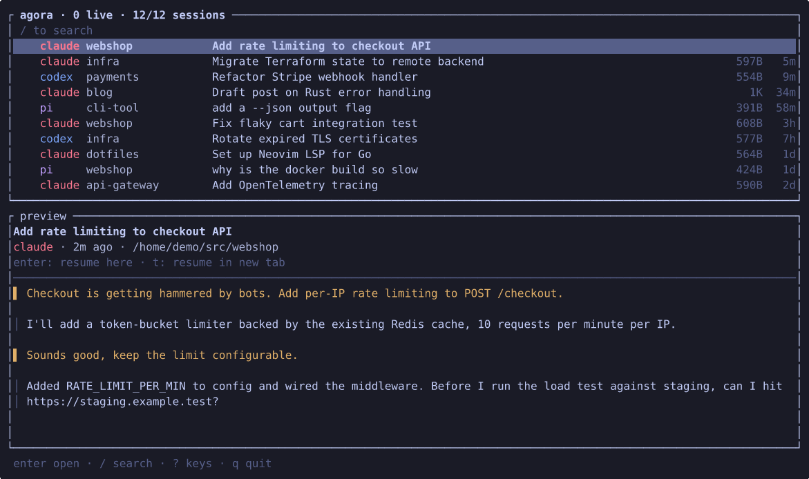

# agora

One terminal UI for your AI coding agent sessions: everything that is running
now, and everything you can resume, across **Claude Code**, **Codex** and **pi**.



- **Live at the top.** Sessions that need you (a 🔔 on their Ghostty tab, or a
  blocked Claude background agent) come first, then ones that are working or open.
- **History underneath**, newest first.
- **Search** by title, project, path or agent as you type, and through the
  conversation text itself a moment later, with the matching passage shown in
  the preview. Every word must match; tool output and file contents don't count.
- **Preview** of the end of the conversation for the selected session.
- **Enter** jumps to the session's Ghostty tab if it is open, attaches to a
  background Claude agent, or resumes the session here in its own directory.
- **t** resumes it in a new Ghostty tab instead, so agora stays open as a dashboard.

No tmux. Live state comes from `claude agents --json` and from Ghostty tab titles
via Ghostty's AppleScript dictionary (macOS, Ghostty 1.3+). Without Ghostty it
still lists and resumes sessions.

## Keys

| Key | Action |
| --- | --- |
| `enter` | jump to tab / attach / resume here |
| `t` | resume (or attach) in a new Ghostty tab |
| `/` | search titles and conversation text; `esc` clears |
| `tab` | cycle agent: all, claude, codex, pi |
| `l` | live sessions only |
| `j` `k` `↑` `↓` `g` `G` | move |
| `r` | reload sessions from disk |
| `q` | quit |

`agora --list` prints live sessions and recent history as tab-separated text, and
`agora --search <words>` prints sessions whose conversation text matches.

## Where sessions come from

| Agent | Transcripts | Title |
| --- | --- | --- |
| Claude Code | `~/.claude/projects/*/*.jsonl` | Claude's AI title, else first prompt |
| Codex | `~/.codex/sessions/**/rollout-*.jsonl` | `~/.codex/session_index.jsonl`, else first prompt |
| pi | `~/.pi/agent/sessions/*/*.jsonl` | first prompt |

## Install

```sh
nix run github:davegallant/agora
```

or add `github:davegallant/agora` as a flake input and install
`agora.packages.${system}.default`. Development: `nix develop`, then `cargo test`. To try your changes against made-up sessions
(your real ones are untouched): `nix develop -c demo/try.sh`.

The demo above is recorded from made-up sessions: `demo/render.sh` seeds a fake
`$HOME`, drives agora through a scripted run and renders the asciinema cast to a
GIF with [agg](https://github.com/asciinema/agg). The `demo` workflow re-records
it when `src/` changes and opens a PR with the result.
